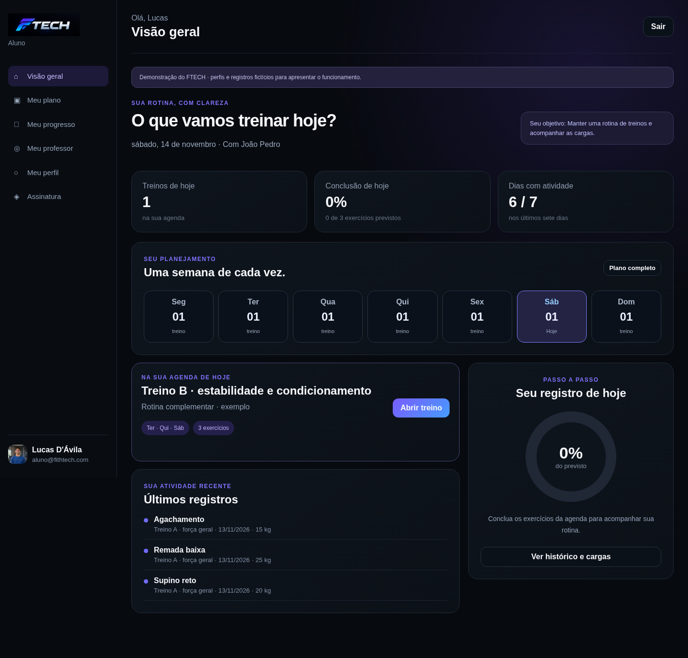
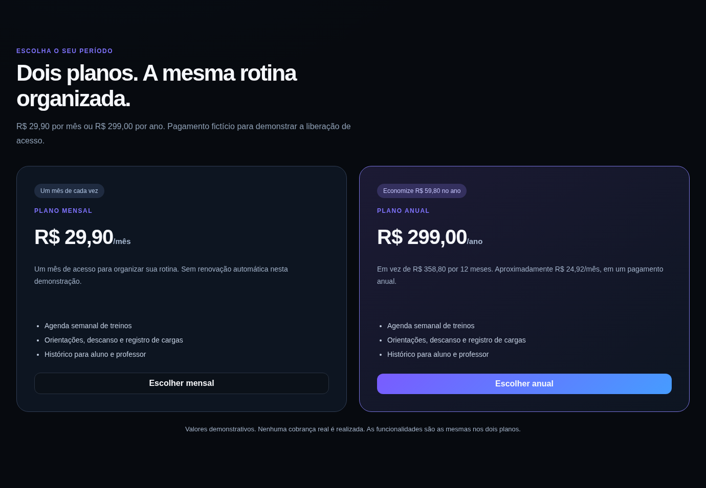

# FTECH · 

**Seu próximo treino. Sem dúvidas.**

O FTECH organiza a relação entre aluno e professor de Educação Física: agenda semanal, prescrição de exercícios, registros diários e histórico das cargas informadas. A proposta é reunir informações que costumam ficar espalhadas em mensagens e planilhas.

**Projeto Integrador II · Análise e Desenvolvimento de Sistemas**  
**Fatec de Taquaritinga · 2026**  
**Integrantes:** Arthur, Emerson, Enzo, Heitor, Kauã e Rafael.


## O que o produto faz

- **Aluno:** escolhe um plano, confirma o pagamento simulado, informa seu objetivo, consulta a agenda semanal, vê séries/repetições/descanso/orientações, usa o cronômetro e registra conclusão e carga opcional.
- **Professor:** escolhe um plano, confirma a simulação, acompanha alunos vinculados, cria e edita a agenda e os exercícios, consulta atividades e cargas, arquiva planos.
- **Administrador:** gerencia usuários, vê quem está sem professor e cria ou encerra vínculos. Administradores não precisam de assinatura.
- **Assinatura:** mensal e anual, cupom fictício, histórico de confirmações e prazo de acesso. A API verifica o acesso; apenas esconder os botões não libera funcionalidades.
- **Primeiros passos:** contas novas recebem orientações sobre perfil, vínculo e recebimento do primeiro treino.

O histórico mostra **atividades e cargas registradas**, sem tratar esses dados como avaliação de resultado físico. As imagens do aluno e do professor são personagens gerados por IA e identificados como ilustrativos.

## Planos e cupom da apresentação

| Plano  | Valor demonstrativo | Com `PARCERIA10` |
| ------ | ------------------- | ---------------- |
| Mensal | R$ 29,90            | R$ 26,91         |
| Anual  | R$ 299,00           | R$ 269,10        |

O anual custa R$ 59,80 a menos que 12 mensalidades e equivale a aproximadamente R$ 24,92 por mês, em um pagamento anual. O cupom fictício aplica 10% sobre o valor do plano escolhido. As contas são feitas no servidor, em centavos; valores enviados pelo cliente não alteram o preço.

**Todo pagamento desta versão é simulado. Não há cobrança real, renovação automática, integração bancária, código Pix ou coleta de dados de cartão.** As opções Pix e cartão servem para demonstrar o fluxo de confirmação. A seção de parceria apresenta uma possibilidade futura, sem vínculo com empresas reais.

## Requisitos

Node.js **20+**, npm e **MySQL 8.0+** ou **MariaDB 10.6+**. Esta entrega foi verificada com Node.js 24, MariaDB 11.8 e Chromium.

## Instalação nova e demonstração completa

Na pasta do projeto:

```sh
npm ci
npm run setup
```

O segundo comando cria `.env` com chave JWT e senha de demonstração aleatórias. Ele **não sobrescreve um `.env` existente**. Configure `DB_HOST`, `DB_PORT`, `DB_USER`, `DB_PASSWORD` e `DB_NAME` conforme seu MySQL.

Para um banco novo dedicado à apresentação:

```sh
npm run db
npm run seed:presentation
npm start
```

Acesse **http://localhost:3000**. No PowerShell, se `npm` estiver bloqueado, use `npm.cmd` nos mesmos comandos.

`seed:presentation` cria contas fictícias com acesso anual de demonstração, perfis preenchidos, três treinos distribuídos na semana e registros ilustrativos dos 21 dias anteriores. Ele não cria conclusões de hoje, permitindo registrar atividades durante a apresentação. Os painéis dessas contas exibem a identificação de demonstração.

| Perfil        | E-mail de demonstração  |
| ------------- | ----------------------- |
| Aluno         | `aluno@fithtech.com`    |
| Professor     | `personal@fithtech.com` |
| Administrador | `admin@fithtech.com`    |

A senha das contas **novas** é o valor de `DEMO_PASSWORD` no seu `.env`. Não há senha universal embutida. Um seed repetido não redefine senhas, perfis, status, vínculos ou treinos existentes. Para gerar o cenário completo, use um **banco novo de demonstração**; se já houver planos, eles são preservados e o histórico fictício não é acrescentado.

`npm run seed:demo` cria um cenário menor, sem histórico fictício. Ambos são bloqueados quando `NODE_ENV=production`. A instalação de estrutura (`npm run db`) não cria contas nem pagamentos.

Para demonstrar o pagamento, crie **uma conta nova pela interface**: as contas pré-preparadas já têm acesso fictício liberado.

## Atualizar banco da versão anterior

1. Faça backup do banco e pare o servidor anterior.
2. Preserve seu `.env` em local seguro e use os arquivos desta versão.
3. Execute `npm ci`; confira as configurações com `.env.example` e uma `JWT_SECRET` aleatória de pelo menos 32 caracteres.
4. Execute **`npm run migrate`** no banco existente.
5. Execute `npm start` e faça login novamente.

Não é necessário executar seed para atualizar. A migração é repetível e mantém usuários, senhas, treinos e histórico. Ela adiciona agenda, objetivo, orientações, descanso, carga e assinaturas. Datas antigas são mantidas; duplicatas antigas de conclusão são preservadas como histórico com os nomes disponíveis.

**Contas que já existiam antes da migração conservam o acesso**, evitando bloquear o projeto anterior. Novos cadastros precisam confirmar um pagamento simulado. Os treinos antigos não recebem dias inventados: ficam com **dias a combinar** até o professor editar a agenda. A pausa padrão dos exercícios antigos é 60 segundos; o professor pode ajustá-la.

Para gerar uma chave JWT:

```sh
node -e "console.log(require('crypto').randomBytes(48).toString('hex'))"
```

## Regras de agenda, registro e assinatura

- Um exercício pode ser concluído uma vez por aluno e data. Envios concorrentes não duplicam o registro.
- A carga é opcional, em kg, de 0 a 2000, com até duas casas decimais. Zero é um valor válido. Use um critério consistente ao comparar execuções do mesmo exercício.
- Desmarcar remove somente a conclusão de hoje e sua carga, preservando os dias anteriores.
- O percentual considera **somente os exercícios agendados para hoje**. Um treino extra, fora da agenda, pode ser registrado no histórico sem alterar esse percentual.
- Sem treino previsto, o painel informa que o dia está livre; treinos sem agenda continuam disponíveis no plano completo.
- Agenda e data dos registros usam `DB_TIMEZONE=-03:00` (Brasília). Evite alterar esse fuso após começar a usar o banco.
- O histórico mantém os nomes registrados, mesmo depois de renomear ou remover exercícios. O gráfico de cargas mostra até 12 registros por exercício, em ordem cronológica.
- Professor desvinculado perde o acesso aos treinos daquele aluno. Os planos ativos anteriores permanecem disponíveis ao aluno; o novo professor pode criar novos planos.
- Desativação/reativação de conta e alteração de senha invalidam os tokens anteriores.
- Um pedido pendente não libera acesso. A confirmação simulada é vinculada ao usuário e idempotente: repetir o mesmo pedido não acrescenta outro período.
- Um novo pedido confirmado acrescenta um mês ou 12 meses ao período ainda disponível. Sem período restante, começa na confirmação. Não há renovação automática.
- Contas sem assinatura válida podem fazer login, consultar/editar o próprio perfil, mudar a senha e acessar o checkout. Treinos, progresso e painéis ficam bloqueados na API até a liberação.

## Capturas e apresentação






O roteiro em **[APRESENTAR.md](APRESENTAR.md)** explica como apresentar o problema, a proposta, os planos, o cupom e o fluxo dos três perfis sem discutir o código.

## Estrutura e tecnologias

Interface HTML/CSS/JavaScript, Express 4, MySQL2, JWT, bcrypt, Helmet e limitação de tentativas. Testes com Node Test Runner e Playwright.

```text
FTECH/
├── database/          # Estrutura e tabela de assinaturas
├── docs/              # Alterações, testes e imagens das telas
├── lib/               # Validação, agenda e cálculo dos planos
├── middleware/        # Identidade e liberação de acesso
├── public/            # Interface, checkout e imagens
├── routes/            # API por funcionalidade
├── scripts/           # Ambiente, instalação, migração e cenários fictícios
├── tests/             # Unitários, integração e navegador
├── .env.example
├── APRESENTAR.md
├── INICIAR.txt
└── server.js
```

## Testes

```sh
npm test
npm run format:check
npm run test:integration
npm audit --omit=dev
```

A integração cria e remove bancos temporários com prefixo `ftech_test_`, usando as credenciais `DB_*`, sem alterar o banco indicado em `DB_NAME`. Exige permissão para criar e excluir esses bancos.

Os testes de navegador alteram dados e devem usar uma **instância exclusiva de demonstração**. Consulte [docs/TESTES.md](docs/TESTES.md).


